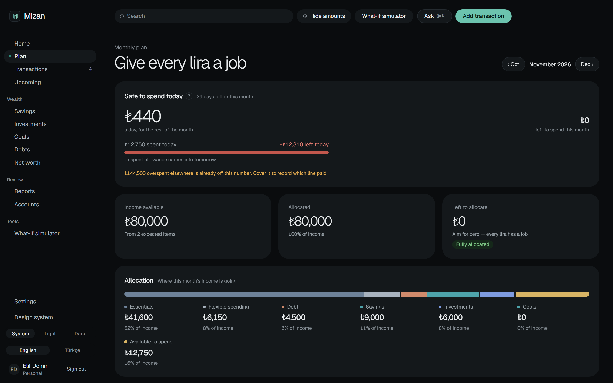
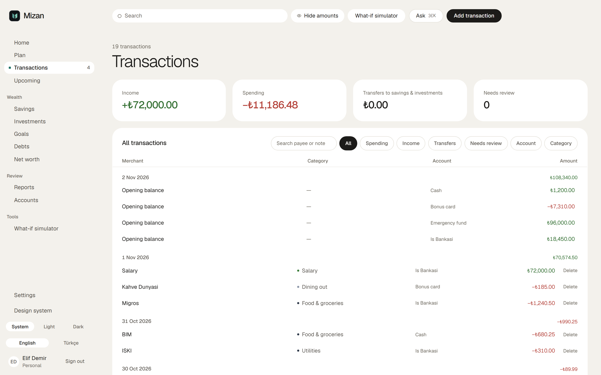
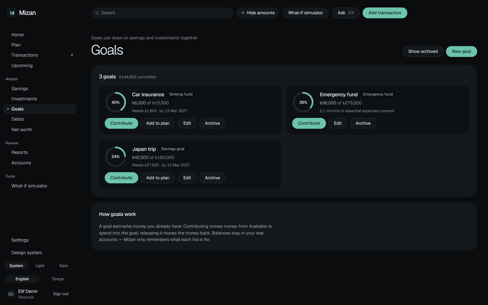
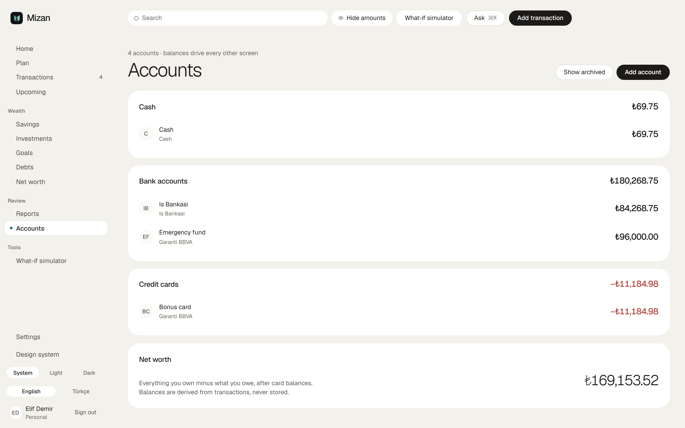
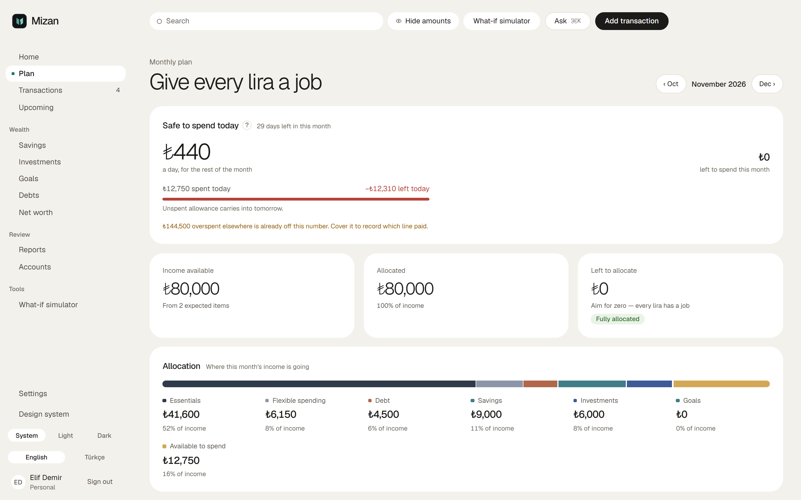

<p align="center">
  
</p>

<h1 align="center">Mizan</h1>

<p align="center">
  Give every lira a job. · Her liraya bir görev ver.
</p>

<p align="center">
  <a href="docs/PLAN.md"><strong>The plan</strong></a> ·
  <a href="docs/adr">Decisions</a> ·
  <a href="docs/glossary.md">Glossary</a> ·
  <a href="SECURITY.md">Security</a>
</p>

<p align="center">
  <a href="https://github.com/Adoocat/mizan/actions/workflows/ci.yml"></a>
  
  
  <a href="LICENSE"></a>
</p>

Mizan is a planning-first personal finance app for people in Türkiye. An expense tracker looks back
and asks where the money went; Mizan looks forward. When income arrives, every lira gets a job —
bills, groceries, debt, savings, investments and a pool that is free to spend — and every screen
afterwards measures reality against that plan. It exists to answer one question each day:
**how much can I safely spend today without hurting my bills, goals or investments?**

> **Status:** in development. Phases 0–9 of 12 are done — accounts, categories, transactions, the
> monthly plan, safe-to-spend, goals and recurring payments all run against the API. Month review,
> the dashboard and release hardening are next. The
> [phase tracker](docs/PLAN.md#phase-tracker) is the live version of this sentence.

## Screens

Captured from the running app against a seeded workspace. Every screen ships in both themes and in
English and Turkish; dark is the design's default, and the system preference wins until you choose.



The plan page is the product in one screen. Income at the top, every category below it, and
**Left to allocate** falling to zero as you assign. **Safe to spend today** is the pool that is
left, divided by the days that remain.

|                                                                          Transactions · light                                                                           |                                                                            Goals · dark                                                                             |
| :---------------------------------------------------------------------------------------------------------------------------------------------------------------------: | :-----------------------------------------------------------------------------------------------------------------------------------------------------------------: |
| [](docs/assets/screenshots/transactions.png) | [](docs/assets/screenshots/goals.png) |
|                                                                          **Accounts · light**                                                                           |                                                                          **Plan · light**                                                                           |
|   [](docs/assets/screenshots/accounts.png)   |                     [](docs/assets/screenshots/plan-light.png)                      |

## Why planning first

| An expense tracker                             | Mizan                                                                                                                                 |
| ---------------------------------------------- | ------------------------------------------------------------------------------------------------------------------------------------- |
| Looks back: _where did it go?_                 | Looks forward: _where should it go?_                                                                                                  |
| Savings is whatever is left over               | Savings and investments are planned before spending                                                                                   |
| Total spent per category                       | One number — **safe to spend today** — with the arithmetic shown                                                                      |
| Separate tools for budget, goals and portfolio | One loop: income → plan → transactions → goals → portfolio → net worth                                                                |
| Prices and returns in nominal lira             | Built for Türkiye: inflation and real returns, gold and FX, TEFAS and BIST, instalments (_taksit_), and a month that starts on payday |

A budget month is anchored to the day you get paid, not to the first of the calendar month. A
category without its own line draws on the shared pool. Leftovers at the end of a period roll over,
move to a goal, or return to the pool — you decide, per line, when the month closes.

## Getting started

Requires **Node 24** (see [`.nvmrc`](.nvmrc)), **Docker** running, and Corepack, which ships with
Node.

```bash
corepack enable
pnpm install
cp .env.example .env
pnpm db:up
pnpm db:migrate
pnpm dev
```

The web app is at <http://localhost:5173>, the API at <http://localhost:3000/api/v1/health>.
`/showcase` renders every component in the design system.

## Tests

```bash
pnpm lint && pnpm typecheck
pnpm test:unit    # every package; the domain runs under coverage thresholds
pnpm test:int     # the API against a throwaway Postgres (Testcontainers)
pnpm test:e2e     # Playwright, after `pnpm --filter @mizan/e2e install-browsers`
```

Financial rules carry golden tests and property tests ([fast-check](https://fast-check.dev)), and
`packages/domain` holds a ≥ 95% branch floor. Integration tests run against a real Postgres, never a
mock, and every endpoint is covered by cross-tenant isolation tests.

## How it is built

A pnpm monorepo in strict TypeScript. React + Vite with TanStack Router and Query on the front,
Fastify on Node 24 at the back — no build step there, since Node runs the `.ts` files directly —
PostgreSQL 18 through Drizzle, and Zod schemas shared by both ends. See
[ADR 0001](docs/adr/0001-stack.md) for why each piece was chosen.

```
apps/web             React SPA
apps/api             Fastify API and background worker
packages/domain      Pure financial logic — money, dates, periods, the budgeting rules
packages/contracts   Zod schemas shared by API and web
packages/config      Shared TypeScript, ESLint and Prettier config
e2e/                 Playwright tests
infra/               Docker Compose for local Postgres
docs/                PLAN.md, ADRs, glossary
design/              Mockups (reference only)
```

Three rules hold the rest together:

- **Money is never a JavaScript number.** Amounts, quantities, prices and FX rates are decimals end
  to end — `NUMERIC` in Postgres, strings over the wire (`{"amount": "12000.00", "currency": "TRY"}`),
  and [decimal.js](https://mikemcl.github.io/decimal.js/) inside the domain. Rounding happens only at
  the persistence and display boundaries; percentage splits use the largest-remainder method, so the
  parts always sum to the whole.
- **The rules live in one place.** `packages/domain` is pure and deterministic — no I/O, no
  `Date.now()`. SQL aggregates, the domain decides, the UI formats.
- **Nothing is stored that can be derived.** Account balances come from transaction lines, holdings
  are a projection of investment events, and future recurring payments are computed, never written
  ahead.

## Design

The high-fidelity mockups in [`design/new-design/`](design/new-design) are the reference for layout,
copy and visual language (design system 2.0, [ADR 0006](docs/adr/0006-design-system-2.md)). The
tokens are ported to semantic names in `apps/web/src/app/styles.css`, which is the source of truth
for code ([ADR 0005](docs/adr/0005-design-tokens.md)). A few light-mode text colours are darker than
the mockup so that both themes pass WCAG AA — Playwright runs axe with contrast checks on each.

## Security

Please report vulnerabilities privately. See [SECURITY.md](SECURITY.md).

## License

[MIT](LICENSE) © Demirkan Doğru
